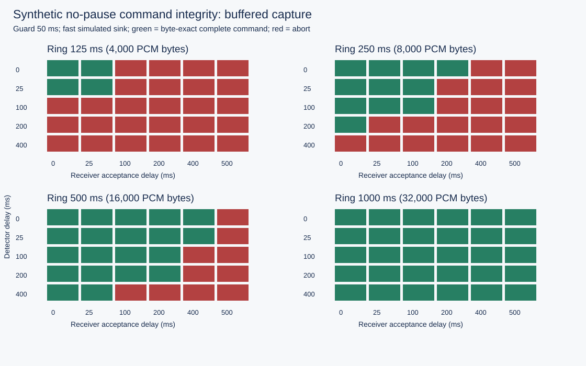

# Edge Voice Handoff

### Preserve the first word when a command starts immediately after the wake phrase.

**Smart India Hackathon · SIH26172 · Prototype Pioneers · Team 160289**

A wake decision arrives after the sound that caused it. If command capture starts at decision time, the beginning of a no-pause command can already be gone. This research codebase implements and validates a bounded capture contract: retain recent PCM, request audio from the estimated keyword endpoint minus a guard, and stream it through an explicit receiver/session protocol.

The work includes byte-exact PCM evidence, paired policy comparisons, capacity boundaries, transport/privacy faults and an independent auditor. It uses synthetic indexed PCM and oracle wake/endpoint events; acoustic recognition and embedded hardware are the next integration stage.

> **Research question:** Can a finite buffer preserve the command onset through detector and receiver delay without silently inventing lost audio?

## Evidence at a glance

| Validation layer | Executed evidence |
|---|---:|
| Expanded experiment | **701 scenarios / 1,402 paired replays** |
| Capacity/delay matrix | **240 scenarios** |
| Exact retention boundaries | **36 scenarios** |
| Seeded clean captures | **250 scenarios** |
| Transport and privacy faults | **175 scenarios** |
| Independently audited accepted packets | **630,511** |
| Independently audited receiver sessions | **1,117** |
| Final Python verification | **30 tests passed** |
| Baseline demonstration | **28 scenarios / 56 paired replays** |
| Isolated replay-control verification | **8 checks passed** |

All 1,402 study runs matched their predeclared software expectations, including deliberate aborts. A passing failure-handling test is distinct from successful command delivery. The full study ran the 27-test suite; three archive/restore tests were subsequently added to the final 30-test suite.

## The golden no-pause result

The baseline fixture contains a one-second command, a 200 ms oracle detector delay and a further 300 ms receiver acceptance delay. Both policies receive identical 16 kHz mono signed 16-bit PCM and timing inputs.

| Result | Naive capture at decision | Buffered capture from endpoint minus guard |
|---|---:|---:|
| Command length | 16,000 samples | 16,000 samples |
| Missing command onset | **3,200 samples / 200 ms** | **0 samples** |
| Complete command integrity | Fail | **Pass** |
| Received command bytes | Incomplete prefix coverage | **Exact, once and in order** |

The one-second ring stores **32,000 PCM payload bytes**. That is the ring payload, not total application RAM. The improvement depends on a usable keyword-end estimate; it does not establish wake-word accuracy or ASR performance.

## A finite promise with an exact boundary

For a clean fast sink, valid startup history and trigger/acceptance before the endpoint, let:

| Symbol | Meaning |
|---|---|
| D | Detector delay |
| G | Requested history guard |
| A | Receiver acceptance delay |
| R | Ring capacity |

Complete buffered capture requires **D + G + A ≤ R**, with all quantities measured in samples.

All 12 tested boundary settings completed one sample below and exactly at capacity, then explicitly aborted at capacity plus one sample. The sender cannot recover overwritten audio from the complete host fixture. Under slow or lossy transport, initial retention alone is insufficient; acquisition continues during drain and the stream can still overflow.



## Full-command integrity, not just completed handshakes

| Study group | Cases per policy | Naive intact commands | Buffered intact commands |
|---|---:|---:|---:|
| Capacity/delay grid | 240 | 38 | **139** |
| Boundary tests | 36 | 9 | **24** |
| Random clean no-pause cases | 250 | 0 | **154** |
| Transport/privacy faults | 175 | 0 | **50** |
| Total | 701 | **47** | **367** |

Naive capture completed 500 handoffs but preserved only 47 complete commands. Buffered capture completed 367 handoffs and preserved all 367 selected commands. The remaining cases are retained as explicit failures. These counts describe the seeded synthetic study and are not population recognition accuracy or deployment reliability estimates.

The fault suite covers dropped and duplicated packets, payload corruption, wrong sample indices, persistent loss, mute during streaming and a sink running at half the acquisition rate. Packet/session identity, sequence, sample range and SHA-256 checks prevent silent concatenation of inconsistent data. Mute zeroes retained PCM and cancels application capture state; already transmitted bytes cannot be recalled.

## Reproduce without a third-party Python dependency

The delivered run uses CPython 3.12.14. No package installation, speech dataset or external service is required.

```powershell
# Unit/property checks, baseline replays, PCM audit and plots
python -I -S run_validation.py

# Full expanded study; use a fresh output directory
python -I -S study.py --out results/my-study
python -I -S verify_artifacts.py results/my-study

# Reduced 31-scenario / 62-replay CI smoke matrix
python -I -S study.py --quick --trials 2 --out results/my-smoke
```

Windows wrapper: `run.ps1`. The baseline replay can be opened with `python serve_viewer.py` at `http://127.0.0.1:8765`. It displays saved evidence and requests no microphone permission. App screenshots are excluded from publication.

## Research package

| Artifact | What it establishes |
|---|---|
| [Expanded study report](docs/STUDY_REPORT.md) | Predeclared matrix, analytical expectations, outcome counts and limitations |
| [Requirements-to-tests mapping](docs/REQUIREMENTS_TO_TESTS.md) | Traceability from capture/privacy requirements to checks |
| [Claim ledger](docs/CLAIM_LEDGER.md) | Supported software findings and unmeasured system claims |
| [Schema](docs/SCHEMA.md) | PCM, session, event and metric contracts |
| [Release checklist](docs/RELEASE_CHECKLIST.md) | Verification status and remaining integration gates |
| [Study results](results/study_20261003/study_summary.json) | Complete grouped outcomes and abort reasons |
| [Per-run metrics](results/study_20261003/summary.csv) | Every policy/case result, including incomplete commands |
| [Independent packet/PCM audit](results/study_20261003/artifact_audit.json) | Byte-exact saved prefixes, contiguous packets and result counts |
| [Archived raw evidence](results/study_20261003/raw_evidence.zip) | Deduplicated fixtures, PCM, events, telemetry and packet records |

`voice_harness/core.py` implements the ring, capture lifecycle and bounded simulated transport. `study.py` generates the experiment and declares expectations. `verify_artifacts.py` checks saved evidence without importing the simulator.

The raw archive stores SHA-256 addressed blobs and an index of their original paths. Restore it after cloning, then independently audit it:

```powershell
python restore_evidence.py results/study_20261003
python -I -S verify_artifacts.py results/study_20261003
python verify_release.py results/study_20261003
```

Restoration verifies every blob and refuses to overwrite different evidence. Git attributes preserve generated result bytes across checkout. The Desktop working copy retains the full raw trees; only the compact archive is published.

## Next engineering milestone

1. Integrate the actual wake detector and causal endpoint estimator.
2. Evaluate held-out consented no-pause speech, noise, accents and false activations.
3. Port the retention/session contract to the selected microphone, board and transport stack.
4. Add delayed/lost acknowledgements, acquisition races and real network behavior.
5. Measure total RAM, deadline misses, CPU and power on the target system.

**The deliverable is a tested handoff contract: preserve complete commands within retention, reject inconsistent transport, and fail explicitly when the finite promise is exceeded.**
